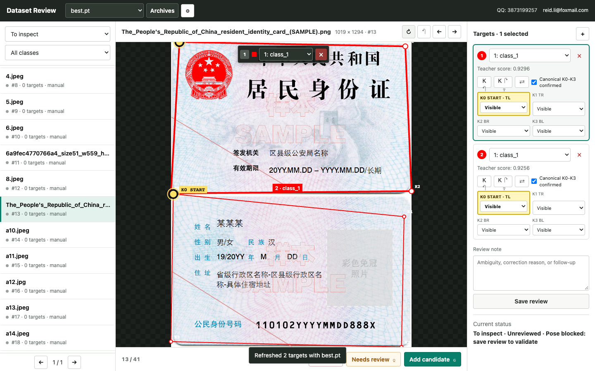
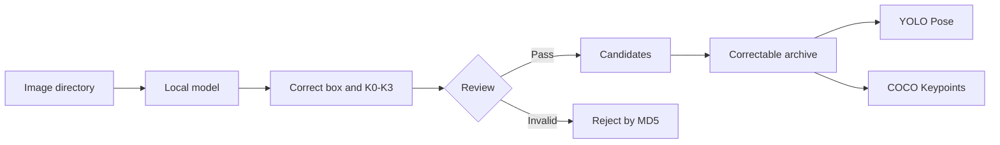
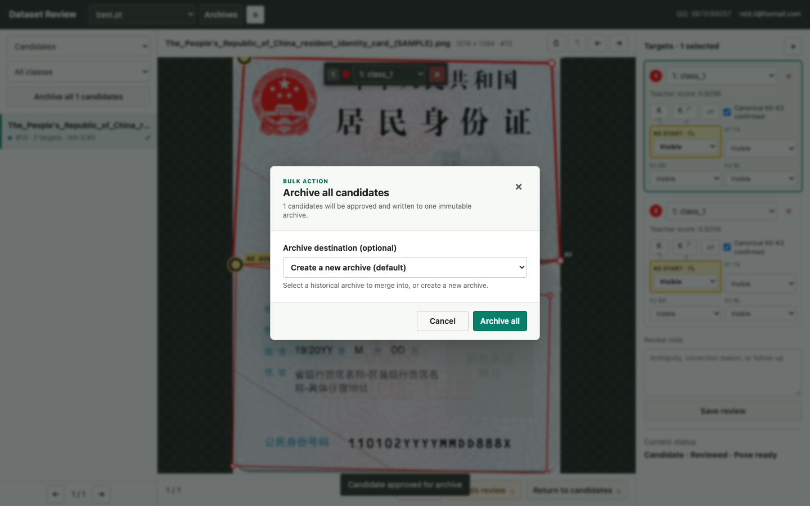
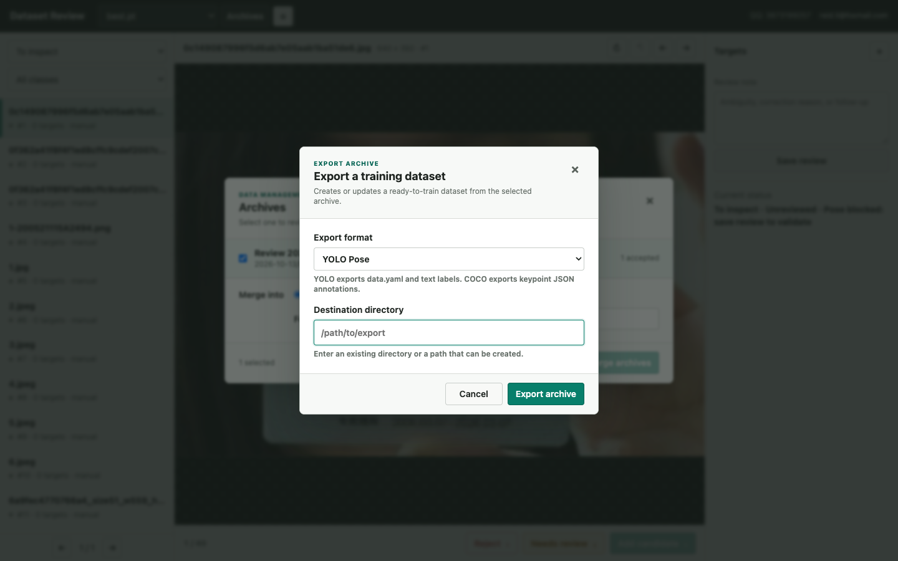

# ID Card Label Tool

Current release: **v1.0.0**

Local tooling to review and correct ID-card detection boxes and four semantic
Pose keypoints.
Input images are read-only. A workspace stores only
candidate data and editable archives, plus its local MD5 index. You can switch
input directories and the workspace excludes images already present in either
candidate or archive data, or previously rejected, by their image-content MD5.

It combines **local model predictions, manual correction, quality review,
editable archives, and training dataset export** in one browser-based
workspace.

## Product Overview



| Feature | Capability | Benefit |
|---|---|---|
| Model-assisted annotation | Refresh detection polygons and four keypoints with a local `.pt` or `.pth` model | Reduces manual drawing |
| Visual correction | Drag corners, add or remove targets, edit classes, set visibility, and undo changes | Handles rotated, occluded, and multi-card images efficiently |
| Semantic keypoints | Enforces `K0..K3` as top-left, top-right, bottom-right, and bottom-left | Keeps Pose labels consistent |
| Quality gates | Separates pending, needs-review, candidate, rejected, and archived states | Prevents incomplete labels from entering training data |
| Correctable archives | Applies reviewed archive edits immediately and tracks the edit count | Prevents known bad labels from remaining in training data |
| Dataset export | Produces YOLO Pose or COCO Keypoints data with train/validation splits | Moves approved data directly into training |



| Batch archiving | Training dataset export |
|---|---|
|  |  |

### Key Advantages

| Characteristic | Advantage |
|---|---|
| Fully local operation | Sensitive images, models, and labels do not need to leave the machine |
| Human-in-the-loop workflow | Model proposals improve speed while human review protects accuracy |
| Read-only input and isolated output | Source images remain unchanged; generated data stays in the workspace |
| Content-based deduplication | MD5 indexing avoids repeated work across input directories |

## Start

```bash
./scripts/idcard-label-start.sh
```

Open `http://127.0.0.1:8765` and choose an input image directory plus an empty
output workspace directory. An empty output directory is valid and will be
initialized after confirmation. The choices are remembered locally. Set the
optional local refresh model directory in the Settings dialog; the directory
and selected model are remembered locally. Set
`REVIEW_OPEN_BROWSER=1` to open the browser automatically.

For an explicit workspace:

```bash
python3 -m idcard_label serve \
  --input-root /path/images \
  --workspace /path/review-workspace
```

## Workflow

Correct targets, optionally press `F` to refresh the current image with the
local model, then use `G` to add it to candidates. Unreviewed queue images are
read directly from the current input directory on demand; they are not stored as
workspace output. Use `R` to reject an image permanently; matching image content
will not return to the queue. Confirm `K0..K3` as top-left, top-right, bottom-right, and
bottom-left in the upright card orientation, then archive candidates.
Each archive contains labels, records, source-image links, and
the class map. The Archives dialog exports one selected archive group as either
a ready-to-train YOLO Pose dataset with `data.yaml`, `images/train|val`, and
`labels/train|val`, or a COCO Keypoints dataset with split images and
`annotations/keypoints_train|val.json`. Only the archive's final accepted
records are included.
Exporting the same archive to the same directory again safely replaces the
previous dataset so archive additions and corrections are reflected.
The archive review list is synchronized from each `annotations.jsonl` manifest.
Editing, rejecting, or marking an archived record for follow-up atomically
updates the archive manifest, record, label, report, and local index before the
save request completes. Non-accepted records are immediately excluded from
training dataset exports.
The most recently used export directory is remembered locally.

Model-assisted refresh is optional. Install `requirements.txt` only when using a
local `.pt` or `.pth` checkpoint to refresh an image's proposed Pose targets.
`./scripts/idcard-label-start.sh` creates `.venv` and installs these dependencies
automatically when they are missing. To use another Python environment, set
`PYTHON_BIN` to its interpreter before starting the tool.

## Test

```bash
./scripts/idcard-label-test.sh
```

## Contact

- QQ: 3873199257
- Email: [reid.li@foxmail.com](mailto:reid.li@foxmail.com)

## License

This project is licensed under the [MIT License](LICENSE).
