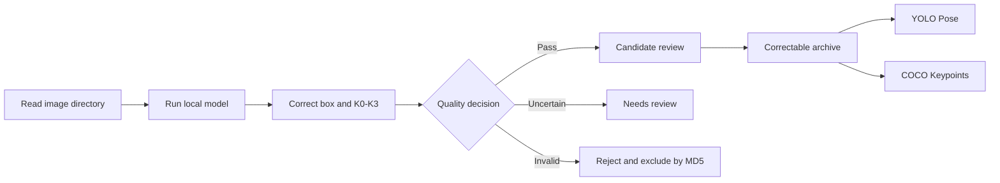

# ID Card Pose Annotation Tool

A local data production tool for ID card detection and pose models. It combines **model-assisted annotation, manual correction, quality review, versioned archives, and training dataset export** to turn raw images into train-ready YOLO Pose or COCO Keypoints datasets.

## Main Workspace

| Area | Purpose |
|---|---|
| Queue | Filter images by review state, archive, and class |
| Canvas | Inspect model predictions and drag the bounding polygon or four corner keypoints |
| Target panel | Edit classes, keypoint order and visibility, and add notes |

## Workflow

## Features

| Feature | Capability | Benefit |
|---|---|---|
| Model-assisted annotation | Select a local `.pt` or `.pth` model and refresh detection polygons and keypoints | Reduces manual drawing and speeds up annotation |
| Visual correction | Drag keypoints, add or remove targets, multi-select, change classes, and undo edits | Handles rotated, occluded, and multi-card images efficiently |
| Semantic keypoints | Defines `K0→K3` as top-left, top-right, bottom-right, and bottom-left; supports order rotation, reversal, and visibility states | Keeps pose labels consistent and reduces training-data errors |
| Quality gates | Separates pending, needs-review, candidate, rejected, and archived states; invalid geometry cannot be archived | Prevents incomplete labels from entering training datasets |
| Batch archiving | Writes reviewed candidates to archives and can merge historical archives | Creates stable, traceable dataset versions |
| Archive corrections | Editing an archived item atomically updates the archive and its index | Removes known bad labels from training data immediately |
| Content deduplication | Uses image-content MD5 to exclude candidate, archived, and rejected duplicates | Avoids repeated work when input directories change |
| Dataset export | Exports a selected archive as YOLO Pose or COCO Keypoints with train/validation splits | Produces data that can move directly into model training |

## Batch Archiving

Reviewed candidates can be archived in one action. Users may create a new archive or merge the batch into an existing archive. Only final accepted records are included.

## Training Dataset Export

| Format | Main output | Best suited for |
|---|---|---|
| YOLO Pose | `data.yaml`, `images/train|val`, and `labels/train|val` | Ultralytics YOLO Pose training |
| COCO Keypoints | Split images and `annotations/keypoints_train|val.json` | COCO-compatible keypoint training frameworks |

## Key Advantages

| Characteristic | Advantage |
|---|---|
| Fully local operation | Images, models, and annotations do not need to leave the local machine, which is important for sensitive identity data |
| Human-in-the-loop workflow | The model proposes labels while reviewers correct and approve them, balancing speed and accuracy |
| Read-only input and isolated output | Source images are not modified; the workspace stores review state, candidates, and archived results separately |
| Keyboard-driven review | Shortcuts cover navigation, model refresh, candidate/reject decisions, target editing, keypoint rotation, and undo |
| Data governance | Immediate archive corrections, edit counters, and archive merging provide practical dataset management |
| Short path to training | Approved data can be exported directly in standard formats without a separate conversion step |
